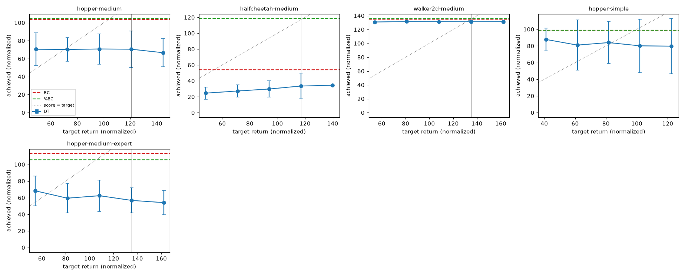

# decision-transformer-offline

A Decision Transformer (DT) written in plain PyTorch and trained offline on Minari MuJoCo datasets, compared with two behaviour-cloning baselines: **BC** (MLP on all data) and **%BC** (the same MLP on the top 10% of timesteps by trajectory return, called `pbc` in the code). Five datasets, three seeds each, three methods: 45 training runs, all finished. Every number below comes from `results/eval.json`, `results/summary.md`, `results/steps_check_*.json`, `extras/*.csv` or `logs/`.

**Live demo:** https://haiha-ux.github.io/decision-transformer-offline/ (the page in `docs/`): pre-rendered Hopper rollouts for four target returns, plus the exported model running in your browser through onnxruntime-web 1.22.0 with a target return you choose.

**Headline, stated plainly:** in this setup the Decision Transformer does **not** beat plain behaviour cloning. BC or %BC is ahead on all five datasets, usually by a lot (details and noise caveats below). This repo is not a reproduction of the paper's results and does not claim to be.

## Results

Score = D4RL-style normalised return, `100 * (return - random) / (expert - random)`, with the D4RL reference returns hard-coded in `dtlib.py` (`REF`). Each run is evaluated for 10 deterministic episodes (for DT: 10 per target return); the per-seed value is the mean of those 10 episodes; the table shows mean +- sample std (ddof=1) over the 3 seeds, with the three per-seed values in brackets (seed 0, 1, 2). "data mean / max" are the normalised mean and best episode return of the training data.

Scores above 100 occur because the references come from the older D4RL environments while the data and the simulator here are Minari / Gymnasium `-v5` (Hopper-v5, HalfCheetah-v5, Walker2d-v5), so these numbers are comparable between rows of this table, not to published D4RL tables.

| Dataset | data mean / max | BC | %BC (top 10%) | DT, target = 1.0 x best data return | DT, best of 5 targets ("oracle") |
|---|---|---|---|---|---|
| hopper-medium | 87.2 / 120.7 | 103.7 +- 4.4 (107.6, 98.9, 104.5) | 104.5 +- 6.9 (107.0, 109.8, 96.7) | 70.5 +- 20.5 (78.4, 47.3, 85.9) | 70.8 +- 16.9 (x0.8) |
| halfcheetah-medium | 99.6 / 116.9 | 54.0 +- 19.7 (76.4, 46.1, 39.5) | 118.4 +- 6.5 (125.0, 118.2, 112.0) | 33.5 +- 16.3 (47.2, 15.4, 37.9) | 34.4 +- 1.2 (x1.2) |
| walker2d-medium | 124.2 / 135.0 | 134.7 +- 0.1 (134.6, 134.6, 134.8) | 135.7 +- 0.6 (135.1, 136.0, 136.2) | 131.3 +- 1.8 (131.9, 129.3, 132.8) | 131.5 +- 1.1 (x0.6) |
| hopper-simple | 51.5 / 102.0 | 98.3 +- 0.3 (98.5, 98.0, 98.2) | 98.7 +- 0.2 (98.7, 98.8, 98.5) | 80.1 +- 32.1 (43.0, 98.5, 98.9) | 87.8 +- 13.9 (x0.4) |
| hopper-medium-expert | 101.6 / 135.1 | 113.1 +- 0.9 (112.5, 112.6, 114.2) | 105.7 +- 8.5 (103.6, 115.1, 98.4) | 56.8 +- 15.1 (57.5, 41.3, 71.4) | 68.3 +- 18.0 (x0.4) |

The "oracle" column picks, per dataset, the target (as a multiple of the best data return) with the best mean over the same evaluation episodes, so it is optimistic by construction; it is shown only to demonstrate that no target rescues DT. The target is always a multiple of the best episode return in that dataset (0.4, 0.6, 0.8, 1.0, 1.2), not an expert return.



Each panel: DT's achieved score against the target it was given (mean and std over 3 seeds), BC and %BC as horizontal lines, the vertical line marks the best episode in the data. If DT followed its target the blue line would follow the dotted diagonal.

DT mean over seeds at each target (0.4, 0.6, 0.8, 1.0, 1.2 x best data return), from `results/eval.json`:

| Dataset | x0.4 | x0.6 | x0.8 | x1.0 | x1.2 |
|---|---|---|---|---|---|
| hopper-medium | 70.5 | 70.2 | 70.8 | 70.5 | 66.6 |
| halfcheetah-medium | 24.5 | 27.2 | 29.7 | 33.5 | 34.4 |
| walker2d-medium | 130.9 | 131.5 | 131.4 | 131.3 | 131.4 |
| hopper-simple | 87.8 | 81.0 | 84.0 | 80.1 | 79.7 |
| hopper-medium-expert | 68.3 | 59.4 | 62.4 | 56.8 | 54.1 |

Training loss curves for hopper-medium (action MSE): `results/loss.png`.

### How to read this honestly

- **DT loses to BC on every dataset.** The gaps are well outside seed noise on hopper-medium-expert (56.8 vs 113.1; the std there is 15.1 vs 0.9) and halfcheetah-medium (33.5 vs 54.0, but BC's own std is 19.7, so this one is noisier; against %BC at 118.4 it is not close). On hopper-medium, DT 70.5 +- 20.5 vs BC 103.7 +- 4.4, all three DT seeds (78.4, 47.3, 85.9) are below all three BC seeds (98.9 to 107.6).
- **Walker2d is a near-tie that still goes to BC.** DT 131.3 vs BC 134.7; the differences are small in absolute terms, but BC's seeds are almost identical (std 0.1) and each DT seed (129.3 to 132.8) is below each BC seed (134.6 to 134.8). Normalised score is saturated here (data max 135.0), so there is little room to differ.
- **BC vs %BC is mostly noise, except on halfcheetah.** hopper-medium 103.7 vs 104.5, hopper-simple 98.3 vs 98.7 and walker2d 134.7 vs 135.7 are all inside one std. On halfcheetah-medium %BC (118.4 +- 6.5) is far above BC (54.0 +- 19.7); BC's episodes there are bimodal (seed 0 returns range from about 780 to 15052 in `results/eval.json`), so the BC number is mostly "how often did this seed's policy collapse". On hopper-medium-expert BC is above %BC (113.1 vs 105.7) with %BC seed spread 98.4 to 115.1.
- **hopper-simple, DT seed 0 collapsed, seeds 1 and 2 matched BC** (98.5 and 98.9 vs 98.3). The mean 80.1 +- 32.1 is therefore two numbers, not one distribution; do not read it as "DT is 18 points worse everywhere".
- **Paper numbers are not compared.** The published DT results use older datasets and environment versions than the Minari `-v0` data and Gymnasium `-v5` here, and I cannot check them offline, so I make no reproduction claim.

## What didn't work

1. **Return conditioning barely works.** The point of a DT is that asking for a higher return gives a higher return. Here the mean score is flat or moves the wrong way as the target rises: hopper-medium 70.5, 70.2, 70.8, 70.5, 66.6; walker2d 130.9 to 131.5; hopper-medium-expert falls from 68.3 (x0.4) to 54.1 (x1.2); hopper-simple falls from 87.8 to 79.7 (driven by seed 0, whose five target means are 72.0, 46.2, 54.9, 43.0, 41.6 against 93 to 99 for seeds 1 and 2). Only halfcheetah-medium rises, 24.5 to 34.4, and not consistently per seed (seed 1 goes 22.0, 25.0, 19.5, 15.4, 33.1). The demo page shows the same thing in-browser: the actions the model outputs for a recorded episode barely change as you move the target slider. The `docs/` videos agree: all four targets ended in a fall after 318 to 337 steps with returns of 1175 to 1295 (`docs/manifest.json`), for targets from 1563 to 4691.
2. **Bimodal Hopper episodes.** DT's episodes on Hopper are mostly either short falls (normalised score roughly 33 to 45) or a full run (roughly 108 to 120), with few in between (see the per-episode `norm` lists in `results/eval.json`). Of the 150 hopper-medium DT episodes (3 seeds x 5 targets x 10), 75 scored below 60; for hopper-medium-expert it is 95 of 150 and hopper-simple 44 of 150, compared with BC/%BC episodes below 60 in 1 of 30 (hopper-medium BC), 0 of 30 (hopper-medium %BC, hopper-simple BC and %BC, hopper-medium-expert BC) and 4 of 30 (hopper-medium-expert %BC). A mean of 70 is therefore a mixture of falls and clean runs, not a mediocre gait.
3. **Training longer did not obviously help.** The main DT runs use 40,000 steps. `results/steps_check_100k.json` and `extras/hopper-medium_dt_100k_s97.csv` are one extra run, seed 97, for 100,000 steps: its five target means are 61.0, 70.1, 65.9, 70.4, 69.9, inside the 47.3 to 85.9 range of the three 40k seeds, with the final training loss at 0.051 against 0.058 for seed 0 at 40k. This is one run on a different seed, so it cannot separate "more steps do nothing" from seed noise; it only shows no sign of the large improvement that undertraining would predict. `results/steps_check_40k_s0.json` re-reports seed 0 at 40k and is identical to the main result (70.0, 75.0, 77.2, 78.4, 66.8).
4. **Little tuning was done, and the one tuning check I ran did not help.** The main grid uses one fixed configuration (below): no sweep over learning rate, context length, return scale or architecture. The diagnostics section below rules out an implementation bug in the model, batcher and rollout on hopper-medium-expert, and shows that the reference learning rate and length (1e-4, 100k steps) do not change the picture on that dataset. What is **not** explained is why DT falls in a majority of hopper episodes while BC does not; the explanations I can think of (the model conditions on its own deterministic past actions at test time but on the dataset's noisy actions in training; model size; one head) are untested.
5. **Scope cuts.** Only 5 dataset configurations were trained (hopper-medium, halfcheetah-medium, walker2d-medium, hopper-simple, hopper-medium-expert). `plot.py` has slots for halfcheetah-simple and walker2d-simple but they were not run. 3 seeds is too few for significance tests; none were done.
6. **Demo limits.** The browser panel replays 100 recorded observations through the model; it is not a closed-loop simulation (no physics in the page), so it shows the model's response to the target, not what the Hopper would do.

## Is it a bug? Diagnostics on hopper-medium-expert

Scripts: `diagnose.py`, `diagnose_rollout_path.py`, `run_ref_hp.sh`; outputs: `results/diagnostics_hopper-medium-expert.json`, `results/diagnostics_hopper-medium-expertref.json`, `results/diagnostics_rollout_path.json`, `results/eval_ref_hp.json`. No training was needed for the first three.

**1. The eval loop builds the same model input as the training batcher.** `diagnose_rollout_path.py` runs the real `eval_dt` loop with the environment replaced by a replay of 16 dataset trajectories (and the model replaced by a recorder that returns the dataset action), then feeds the recorded eval windows and the matching training-style windows to the seed-0 checkpoint, at steps t = 0, 3, 18, 19, 20, 60, 300. Largest action difference 3e-7, largest state difference 0, largest return-to-go difference 3e-6 (float32 rounding of the per-step decrement). So token order, left padding, timestep indices, the RTG decrement, and the observation normalisation (checkpoint mean/std equal the batcher's) agree between training and rollout. Not covered: the real simulator, only the input construction.

**2. The "bimodal" premise is only partly true for this data.** In the cached Minari data (1.9986M steps, 2413 episodes, first 1326 episodes = the `medium` half, last 1087 = `expert`), the `medium` half is not a low-return policy: its median episode return is 3567 (5th to 95th percentile 1596 to 3678), the `expert` half has median 4139 (2290 to 4238). Both are above the D4RL expert reference (3234) used for the score. The overall histogram is one low cluster (about 800 episodes below 3400, mostly 1400 to 2400) and two close high clusters (around 3400 to 3700 and 4000 to 4400). Return does separate good from bad episodes, but medium and expert overlap heavily at the top, so "return tells medium from expert" is much weaker than in the paper's datasets.

**3. Eval targets versus training return-to-go.** Best data return 4376. Training RTG at t = 0 has 1st/25th/50th/75th/99th percentiles 1430, 2294, 3623, 4128, 4271. The five eval targets (1750, 2626, 3501, 4376, 5252) are inside that range except 5252, which is above every training value at t = 0; the x1.0 target is at the very top of the range. Time alignment is verified in point 1.

**4. The model uses RTG only weakly.** 3000 windows from the training distribution (no separate held-out split exists; BC and DT are compared on the same windows), action MSE per checkpoint (seeds 0, 1, 2): true RTG 0.0559, 0.0562, 0.0560; RTG shuffled across windows 0.0568, 0.0569, 0.0565; constant RTG at the dataset mean 0.0572, 0.0573, 0.0566; BC (seeds 0 to 2) 0.0548, 0.0547, 0.0542 on the same windows. Shuffling RTG raises DT's error by about 0.8 to 1.6%. Replacing the whole window's RTG by a constant 1000 versus a constant 3500 moves the predicted action by a mean absolute 0.018 to 0.024 per dimension, against a mean absolute action of 0.53. Splitting by data half (1500 full windows each, `by_group_full_windows` in the json): medium 0.018 to 0.028, expert 0.019 to 0.024. The MSE barely moves because most of the action variance is noise the return does not explain, so a tiny training signal for RTG is what the data gives, not necessarily what a bug produces. DT's offline MSE is slightly above BC's (0.0559 vs 0.0548), i.e. it does not even fit the actions better with the extra input.

**5. Reference hyperparameters (lr 1e-4, 100k steps), 2 seeds, same 5 targets, 10 episodes each** (`run_ref_hp.sh`, adds `--lr` and `--tag` to `train.py`; the 45-run grid is untouched). Mean normalised score per target (x0.4 to x1.2 of 4376):

| Run | 1750 | 2626 | 3501 | 4376 | 5252 | final train loss |
|---|---|---|---|---|---|---|
| ref seed 0 | 71.4 | 51.1 | 51.2 | 55.3 | 49.5 | 0.0646 |
| ref seed 1 | 55.2 | 50.5 | 44.8 | 34.8 | 32.8 | 0.0645 |
| main grid, seed 0 (lr 3e-4, 40k) | 81.4 | 47.3 | 57.6 | 57.5 | 46.1 | 0.0631 |

(Main-grid means over 3 seeds: 68.3, 59.4, 62.4, 56.8, 54.1; BC 113.1.) The reference setting is no better, and seed 1 gets worse as the target rises. Its offline MSE is 0.0570 and 0.0574, and shuffling RTG still changes it by 1 to 2%. Two seeds and one dataset: this does not exclude gains from the other differences from the paper (warmup 10k in the reference code versus 1000 here, other dataset, other environment version).

**Verdict.** No implementation bug was found on hopper-medium-expert; the rollout input path is numerically identical to the training path, the target range is sensible, and the model's low RTG sensitivity is what the training loss rewards on this data. It is not a plain learning-rate/length issue either (1e-4, 100k steps does not help). It looks like a property of this data plus this small model: noisy dataset actions, little return signal between the two good clusters, and a closed-loop failure mode (falls) that BC does not show. I did not establish the mechanism of the falls. Everything here is for hopper-medium-expert; the other four datasets were not re-diagnosed.

## Method

| Part | Choice (all in `dtlib.py` / `train.py`) |
|---|---|
| DT tokens | Per step: return-to-go, state, action, interleaved; action for step t is read from the state token, so it sees the target and the state but never the action it predicts |
| DT size | 3 blocks, width 128, 1 head, dropout 0.1, learned timestep embedding (max 1001), context K = 20 |
| DT training | 40,000 steps, batch 64 windows, AdamW lr 3e-4 (weight decay 1e-4), 1000 warmup steps, cosine to 1% of lr, grad-norm clip 0.25, loss = action MSE on real (non-padding) tokens |
| Return-to-go | Undiscounted suffix sums divided by 1000 (`RTG_SCALE`); at test time the target is decremented by the observed reward each step |
| Evaluation target | `{0.4, 0.6, 0.8, 1.0, 1.2} x` the best episode return in that dataset; 10 episodes per target, env seeds `(seed + 1) * 10000 + episode index` |
| BC | MLP 3 hidden layers of 256 with ReLU, tanh output, 10,000 steps, batch 256, AdamW lr 1e-3, cosine, grad-norm clip 1.0 |
| %BC | Same as BC on the highest-return trajectories until they cover 10% of timesteps (`top_pct_trajs`) |
| Data | Minari `mujoco/<env>/<kind>-v0`; `medium-expert` = medium + expert concatenated. Observations normalised with training-data mean/std |
| Compute | DT on one GPU capped at 30% memory (about 5 to 6 minutes per hopper-medium run in `logs/*.time.json`: 341, 314, 325 s), BC and %BC on CPU (hopper-medium: 46 to 148 s); the machine was shared, so timings are not clean |

## Demo

`docs/index.html` (published at the link above) has two parts: (1) a slider over four pre-rendered Hopper videos, one episode per target at a fixed env seed, not selected; (2) a **live probe**: `docs/probe.js` runs `docs/hopper_dt.onnx` in the browser with onnxruntime-web **pinned to 1.22.0** from jsdelivr, over the 100 recorded states in `docs/probe.json` (written by `make_probe.py`), with any return-to-go you choose, and plots the 3 predicted action dimensions against the actions recorded at target 3909. The ONNX model is the seed-0 hopper-medium checkpoint, the same one used for the videos.

Checks done: every file the page references returns 200 from `python -m http.server` (index, probe.js, probe.json, hopper_dt.onnx, the 4 mp4s) and the three CDN files (`ort.min.js`, `ort-wasm-simd-threaded.wasm/.mjs` at 1.22.0) return 200; and `probe.js` run under Node with onnxruntime-web 1.22.0 matched a PyTorch re-implementation of the same windowing to a max absolute action difference of about 5e-7 at targets 3909, 1000 and 5000. Also opened in Chromium: the model loads, the slider re-runs it, and the canvas draws.

## Reproduce

```bash
python3 -m venv .venv && .venv/bin/pip install -r requirements.txt   # pinned versions used here
.venv/bin/pytest -q tests                                  # 6 tests: return-to-go, score formula, attention mask, causality, padding invariance, top-10% selection
.venv/bin/python train.py --algo dt  --dataset hopper-medium --seed 0   # also --algo bc | pbc; datasets downloaded by Minari on first use
./run_all.sh                                               # whole grid (3 seeds x 5 datasets x dt/bc/pbc), sequential; runs eval.py after each seed
.venv/bin/python eval.py                                   # -> results/eval.json (skips runs already present)
.venv/bin/python plot.py                                   # -> results/summary.md, target_sweep.png, loss.png
.venv/bin/python export_onnx.py && .venv/bin/python make_probe.py   # -> docs/hopper_dt.onnx, docs/probe.json
MUJOCO_GL=egl .venv/bin/python make_demo.py page          # -> docs/hopper/*.mp4 (needs ffmpeg)
cd docs && python3 -m http.server                          # local demo
```

Versions used: Python 3.12, torch 2.11.0, gymnasium 1.3.0, mujoco 3.17.0, minari 0.5.4, numpy 2.3.5, onnx 1.18.0, onnxruntime 1.22.1. Runs are seeded; I have not checked bit-for-bit reproducibility across machines or between GPU and CPU. `data/` (datasets) and `ckpt/` (trained checkpoints) are not in the repository, so `eval.py`, `export_onnx.py`, `make_probe.py` and `make_demo.py` need the training grid to be re-run first.

## Files

| File | Role |
|---|---|
| `dtlib.py` | Data loading and batching, `DecisionTransformer`, BC MLP, rollout evaluation, normalised score |
| `train.py`, `eval.py`, `plot.py`, `run_all.sh` | One training run, evaluation to `results/eval.json`, tables and figures, the full grid |
| `export_onnx.py`, `make_probe.py`, `make_demo.py` | ONNX export with parity check, probe data for the page, rendering of the videos |
| `tests/test_core.py` | Unit tests for the pieces above |
| `logs/` | Training loss CSV and timing for every run, plus `run_all.log`, `eval_all.log` |
| `results/` | `eval.json` (all 45 runs), `summary.md`, figures, `steps_check_*.json` |
| `diagnose.py`, `diagnose_rollout_path.py`, `run_ref_hp.sh` | Diagnostics and the lr 1e-4 / 100k-step side runs (outputs `results/diagnostics_*.json`, `results/eval_ref_hp.json`) |
| `extras/` | Loss log of the 100k-step side run |
| `docs/` | The demo page and its assets |

## License

MIT. Author: Ha Phan Thanh Hai.
